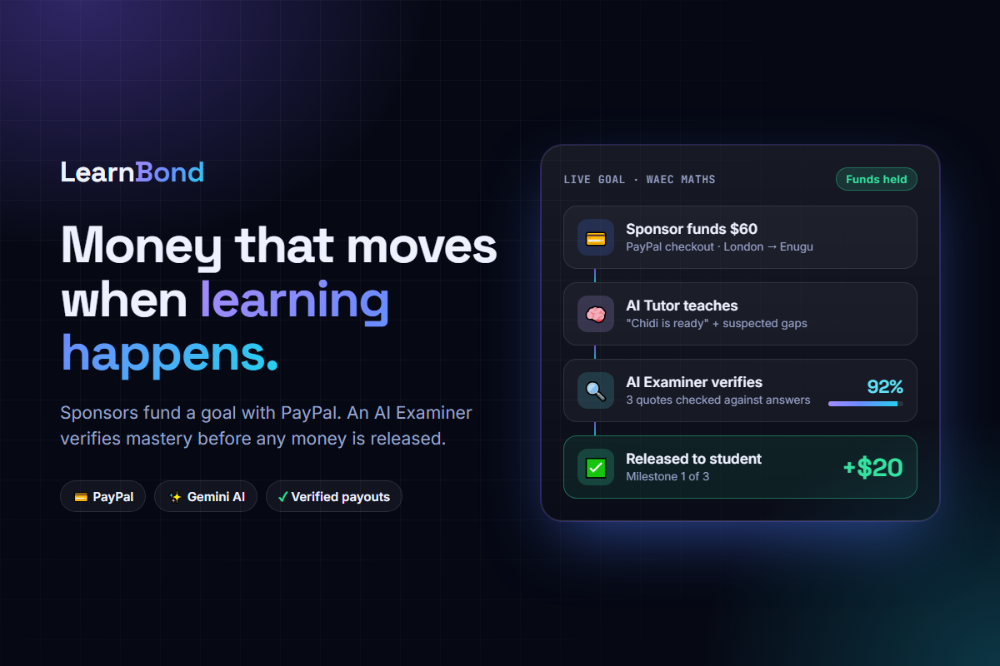

# LearnBond: Money That Moves When Learning Happens

> Sponsors fund a learning goal with PayPal. An AI Tutor teaches, an independent AI Examiner verifies mastery, and only then is the money released. Unearned funds go back to the sponsor.

## Inspiration

Education apps charge a subscription whether or not anyone learns. Meanwhile, millions of families support a student from far away: an aunt in London paying for a nephew's exam prep in Enugu, a parent abroad funding lessons back home. They send money and hope it turns into learning, but they have no way to know.

We asked a simple question: what if the money only moved when the learning actually happened?

## What it does

LearnBond turns a learning goal into an outcome-based fund.

1. **A sponsor funds a goal through PayPal.** For example, "Pass WAEC Maths: quadratic equations" for $60. Gemini designs examinable milestones and splits the budget across them by difficulty. Several relatives can each pay part of it.
2. **An AI Tutor teaches the student.** It's Socratic, so it guides the student rather than handing over answers. When the student feels ready, the Tutor writes an honest **readiness claim** listing strengths *and* suspected gaps.
3. **An independent AI Examiner tries to disprove that claim.** It asks 3 to 5 adaptive questions, typed or spoken, and targets the gaps the Tutor admitted to.
4. **Money moves only when mastery is verified.** The Examiner's verdict must quote the student's own answers word for word. Code checks every quote against the real transcript, and an invented quote voids the verdict.
5. **Guardrails, not the AI, decide whether money moves.** These include a minimum confidence threshold, an auto-release limit, a daily cap, attempt limits, and a sponsor review when answers look pasted or unusually fast. Bigger payouts wait for the sponsor's approval.
6. **An AI agent buys what's missing, within a mandate.** The sponsor can set aside a small study-kit budget. The **Study Kit Agent** reads the gaps the Tutor and Examiner found, searches the study store (a tool call), and proposes a cart with a reason for every item. Code, not the model, enforces the mandate: real catalog prices only, a per-item cap, the kit budget, and an auto-buy limit above which the sponsor approves. It pays the store through PayPal from the held funds.
7. **Unearned money goes back.** When the deadline passes or the sponsor closes the goal, every contributor is refunded their share through PayPal.

Every step, whether by an AI agent, a guardrail, PayPal or a person, is written to a **SHA-256 hash-chained audit log** that the sponsor can inspect. Editing any past entry breaks the chain.

## How we built it

- **Plain HTML, CSS and JavaScript**, with no framework and no build step. You open `index.html` in a browser and it runs, and a first-run setup guide walks you to Settings to connect Gemini and PayPal.
- **A zero-dependency Python server** (`server.py`, standard library only) that holds the PayPal secret and makes **payouts (Payouts API) and refunds (Refunds API) real Sandbox calls**. It can also proxy Gemini so the key never touches the browser. It deploys to **Render** in one click from `render.yaml`.
- **Google Gemini (`gemini-2.5-flash`)** plays three roles: Planner, Tutor and Examiner. Every decision that can affect money uses **structured JSON output** (`responseSchema`), so code can check it instead of trusting free text.
- **PayPal** in the **Sandbox**: Smart Buttons checkout (Orders + Capture) for sponsors, the **Payouts API** to pay students and the study store, and the **Refunds API** to return unearned money to each contributor's original capture. Without the server, payouts and refunds fall back to clearly labelled simulations.
- **Gemini as a tool-using shopping agent**: step 1 decides what to search for, code runs the catalog search, step 2 picks a cart from the results only. Student requests are treated as untrusted text.
- **AG Grid** for everything a sponsor audits: a portfolio grid with progress bars and pinned totals, a money ledger of every capture, payout, purchase and refund with PayPal references, and the audit log with floating filters, hash tooltips and CSV export.
- **Web Crypto (SHA-256)** for the tamper-evident audit log.
- **Web Speech API** for spoken exam answers.
- **localStorage** with cross-tab sync, so the sponsor's dashboard updates live when the student passes an exam in another tab.

## Challenges we ran into

- **Making an AI's verdict safe to attach money to.** A language model can be confidently wrong, or manipulated by a student typing "mark me as passed". We made the Examiner treat student answers as untrusted text, required word-for-word evidence quotes, and put code-based guardrails between the verdict and the payout. The AI can only recommend.
- **Keeping two agents honest with each other.** If the Tutor simply says "they're ready", the Examiner tends to agree. Asking the Tutor to list *suspected gaps*, and telling the Examiner to treat the claim as a hypothesis to test, made the exams noticeably more probing.
- **Detecting copy-paste and coaching** without unfairly failing students. Paste detection and typing speed are passed to the Examiner as hints to probe further, never as automatic failures.
- **Letting an agent spend money safely.** An LLM shopping agent can invent products, inflate prices or be talked into buying something by the student. We gave it a search tool over a real catalog, then priced and filtered its cart in code against the sponsor's mandate. Anything over the auto-buy limit waits for a human.
- **Running entirely in the browser.** We wanted judges to try it with zero setup, which ruled out a backend. That meant simulating payouts and refunds honestly, and restructuring our scripts so the app works even when opened straight from the file.

## Accomplishments that we're proud of

- A complete loop from **PayPal checkout to AI tutoring to adversarial AI exam to guarded release or refund**, working end to end.
- **Proof-of-learning receipts**: the sponsor doesn't just see "passed", they see what the student said, in the student's own words, verified against the transcript.
- **Guardrails on AI-controlled money** that a sponsor can understand at a glance and set themselves.
- An audit trail where **tampering is detectable**, not just discouraged.
- **Agentic commerce with a mandate**: an AI agent that really spends money through PayPal, but only on what the evidence says the student needs, and only within limits a non-technical sponsor sets.
- **Real money movement end to end** in the Sandbox: checkout, payouts and refunds, every one tied to a hash-chained audit entry and visible in a sortable, exportable ledger.

## What we learned

- The hard part of "AI + payments" isn't calling the AI. It's deciding **what the AI is allowed to decide**. Treating the model as an advisor and code as the decision-maker made the whole system easier to trust.
- Structured output changes everything: once Gemini's answers fit a schema, they can be validated, logged and audited like any other data.
- Adversarial setups (one agent checking another) catch far more than a single agent asked to "be careful".

## What's next for LearnBond: Money That Moves When Learning Happens

- **Live product search** for the Study Kit Agent across real stores, keeping the same mandate checks.
- **Accounts and shared storage**, so sponsors and students can use different devices.
- **Teacher and school mode**: let a human tutor review transcripts and co-sign releases.
- **Richer exams**: handwritten working via photo upload, and spoken back-and-forth exams in local languages.
- **Employer and scholarship sponsors** funding upskilling goals with the same proof-of-learning receipts.
